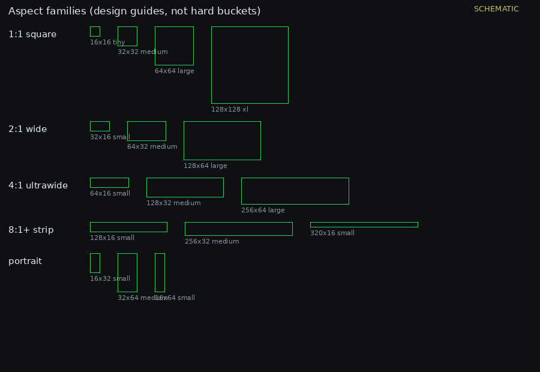
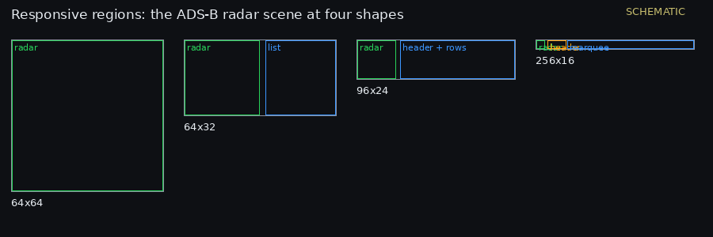
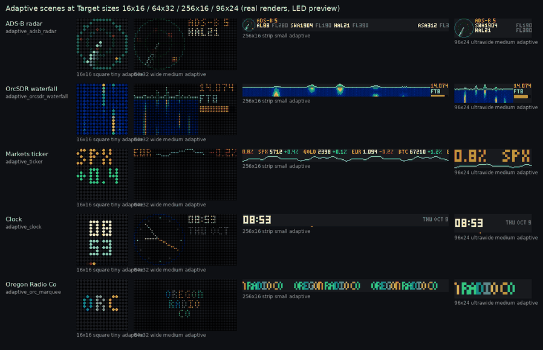
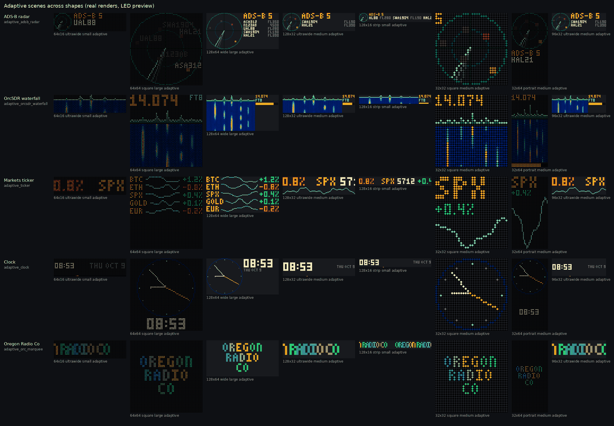
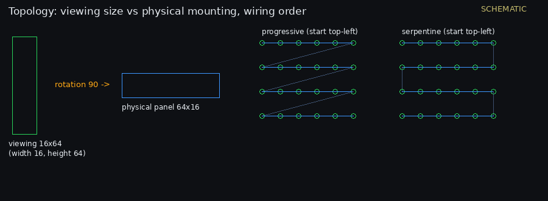

# OrcPixels display design: adaptive layouts

> "If we get that foundation right now, OrcPixels could accommodate a 16×16 badge, a 64×32 HUB75 panel, a 256×16 marquee, or a custom 96×24 matrix without manually producing an entirely new animation library for every device. The Windows installer would then introduce users to a platform with room to grow, rather than software tied to two display sizes."
> (design notes, 2026-10-09)

Those four sizes (16x16, 64x32, 256x16, 96x24) are the regression-test and preview target set for the adaptive work.

## 1. Three independent properties

| Property | Decides | In code |
|---|---|---|
| **Aspect ratio** | composition: what goes where | `layout.classify(w, h)` → `Ctx.family` |
| **Pixel dimensions** | level of detail: text space, icon complexity, line thickness, animation fidelity, how much history | `layout.tier(w, h)` → `Ctx.tier` |
| **Hardware topology** | how the finished image maps to physical LEDs | `drivers.base.Layout`, display profiles |

Aspect ratio is not the only criterion. The aim is to stop hand-maintaining artwork for every resolution while keeping the quality of the animations already made.

## 2. Aspect families



| Family | Sizes | Used for |
|---|---|---|
| 1:1 square | 16x16, 32x32, 64x64, 128x128 | radars, clocks, icons, visualizers |
| 2:1 wide | 32x16, 64x32, 128x64 | split-screen, compact dashboards, scrolling |
| 4:1 ultrawide | 64x16, 128x32, 256x64 | spectrum, banners, tickers |
| 8:1+ strip | 128x16, 256x32, 320x16 | marquees, signal trails, progress bars |
| Portrait | 16x32, 32x64, 16x64 | vertical status, meters, stacked info |

`classify()` boundaries (w/h): square < 1.5, wide < 3, ultrawide < 6, strip from 6; portrait is the mirror (≤ 1/1.5), and "tall" below 1/3. Families are **design guides and compatibility fallbacks, not hard requirements**. A 96x32 panel (3:1) sits between wide and ultrawide, and the renderer lays it out from its real regions rather than forcing it into either family.

**Orientation matters.** 64x16 is 4:1 and 16x64 is 1:4. A panel can be mounted rotated, but the *intended viewing orientation* decides the layout. Rotation can reuse assets for graphics, but text-heavy layouts are recomposed for portrait (see the clock and ADS-B scenes).

## 3. Adaptive scenes (the normal rendering path)

Normal rendering is **adaptive**: the renderer works out the available regions and the scene lays itself out, like responsive web design. Each scene keeps one animation (same motion, same loop length) and only changes its composition. Preset-specific rules decide when to stack, split or simplify.



The worked example is the ADS-B radar:

- **square:** a large radar circle with targets (callsign labels from the large tier up);
- **wide:** the radar on the left, callsigns and altitudes on the right (paged when they don't fit);
- **ultrawide / strip:** a compact radar plus a horizontal status area (a header and a seamless marquee);
- **portrait:** the radar on top, the list below;
- **tiny:** secondary labels are dropped and the moving targets get emphasis.

### How a layout declares itself (phase 3: the shared layout context)

```python
from orcpixels.scenes import scene
from orcpixels.layout import Ctx

@scene("adaptive_clock", "Clock", "square: analog; wide: analog + digital; strip: digital + seconds dot", 60, 1000)
def clock(ctx: Ctx, img, k, n):          # k = frame in the loop, n = loop length
    R = ctx.rect                          # Rect(0, 0, w, h)
    if ctx.tier == "tiny": ...            # detail tier from pixel counts
    if ctx.aspect < 1.5: ...              # composition from the real aspect
    left, rest = R.split_x(ctx.h, gap=2)  # regions: split_x / split_y / square() / inset()
```

`Ctx` gives `w, h, aspect, family, tier, orientation, rect, text_scale()` and a fixed `now` for previews and tests. The loop length comes from the scene (`loop`), so every size loops seamlessly with the same timing. Marquees use `marquee_strip()`, which pads the strip so it moves a whole number of pixels per frame and wraps exactly after `n` frames.

### Detail tiers (from pixel counts)

| Tier | Rule (short side `s`, area) | Typical | What changes |
|---|---|---|---|
| tiny | `s < 12` or area ≤ 256 | 16x16, 32x8 | no secondary labels, bold targets, single readouts |
| small | `s < 24` | 64x16, 256x16, 96x16 | one or two 3x5 text rows, marquees |
| medium | `s < 48` | 64x32, 96x24, 128x32 | header + rows, sparklines, info columns |
| large | `s < 96` | 64x64, 128x64 | 2x text, labels next to objects, longer history |
| xl | `s ≥ 96` | 128x128 | 3x text, full detail |

### The five adaptive presets (phase 4)

`adaptive_adsb_radar`, `adaptive_orcsdr_waterfall`, `adaptive_ticker`, `adaptive_clock` and `adaptive_orc_marquee` (Oregon Radio Co) are in `orcpixels/scenes.py`.





## 4. Layout strategies

They are selectable per display (`Try the resolution` in the Presets tab, the `strategy` API parameter) and per preset.

- **Adaptive** (default): adaptive scenes compose for the panel. Fixed presets use their native master, or an integer upscale of the same aspect (Scaled), and only then Contain.
- **Contain:** letterbox the best master (closest aspect) into the panel.
- **Crop:** fill the panel and crop the overflow.

Fill or letterbox is only a fallback, never the normal path for adaptive scenes.

## 5. Golden references

All existing 64x16 (`presets/`) and 64x64 (`presets64/`) assets, plus every Live Data screen rendered from the recorded fixtures at a fixed time, are **golden references**. `tests/golden/*.json` stores their hashes, and `tests/test_adaptive.py::test_golden_references_unchanged` fails if any output changes. To change one deliberately, regenerate the asset and then run `python tools/golden.py --update` in the same commit.

The 64x64 set is the 1:1 master and the 64x16 set the 4:1 master. They are never re-rendered for other sizes. At other sizes they are Scaled or Fallback.

## 6. Compatibility rating

The rating is shown per preset in the UI (the badge on each Presets tile is for the selected display) and in `Try the resolution`.

| Rating | Meaning |
|---|---|
| **Native** | designed and tested for exactly this resolution (the golden 64x16 / 64x64 assets) |
| **Adaptive** | generated with an appropriate layout for this display (adaptive scenes) |
| **Scaled** | rendered from another resolution without structural change (integer upscale, same aspect: 128x32 from 64x16) |
| **Fallback** | letterboxed or cropped |

## 7. Display profiles and topology



- **Phase 1 (done):** profiles and displays take any `width` x `height` (4 to 512 per side).
- `width` x `height` is the **viewing size**, meaning how the panel is looked at. `layout.rotation` (0/90/180/270) is how it's physically mounted, and the driver applies it after composing. A 64x16 strip mounted vertically is `width 16, height 64, rotation 90`.
- Wiring (`layout`): `serpentine` (zig-zag rows) or progressive, `flip_x` / `flip_y` (which select the start corner), and `order` (rgb, grb, ...).
- **Phase 6 (later):** WLED-style panel chaining (several panels with per-panel offset, rotation and start corner), arbitrary pixel maps (a JSON list of LED indices) and masks (non-rectangular arrays: the renderer draws a rectangle and the mask drops the pixels that don't exist). WLED's 2D matrix and ledmap.json are the reference for this layer.

## 8. Phases

| Phase | Work | Status |
|---|---|---|
| 1 | Arbitrary width and height in display profiles | done |
| 2 | Automatic orientation plus aspect-family classification | done (`layout.classify`, `Ctx.orientation`, viewing vs rotation) |
| 3 | A shared layout context passed to the Python animation generators | done (`layout.Ctx`, `scenes.scene`) |
| 4 | Five representative presets made resolution-adaptive | done (ADS-B radar, OrcSDR waterfall, ticker, clock, Oregon Radio Co) |
| 5 | Automated visual regression and loop tests across dimensions | done (`tests/test_adaptive.py`: target sizes plus 8 more shapes, golden hashes) |
| 6 | Custom pixel mapping, masks and panel topology | later |

## 9. Tools

- `python tools/adaptive_sheet.py OUT`: contact sheets of the scenes at the target sizes and across shapes, plus fixed presets per strategy.
- `python tools/golden.py [--update]`: check or refresh the golden references.
- `python tools/design_schematics.py`: the schematics in `docs/img/`.
