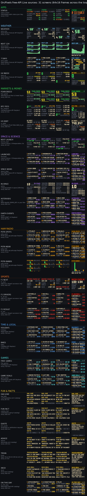
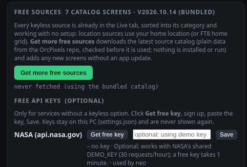

# Live sources and categories

The Live tab groups every live screen by category. Each category is a collapsible
section with an "all" switch, and each screen has its own **on** switch, which adds it to
the rotation. The search box filters by name, source, key or category. Live screens are
drawn by code from the data, so a screen costs a feed and a draw function, not an
animation library.

| Category | Screens |
|---|---|
| Apps | GitHub, service status board, plus shortcuts to OrcSDR Live and the AI status (Codex / Claude / Grok / ChatGPT) cards |
| Weather | weather now, forecast, alerts, air quality (NWS, US); world weather now, next 12 h, 7 days, UV (Open-Meteo, anywhere) |
| Markets & Money | stocks, indexes, crypto, commodities, forex, market clock, sparkline, rates, crypto Fear & Greed, Bitcoin fees + block, US debt |
| News | NPR, BBC, Hacker News, Oregon, tech, ARRL, r/amateurradio, X (optional token) |
| Space & Science | Kp + solar wind, X-ray flares, ISS, earthquakes, next launch countdown, upcoming launches, space news, people in space, asteroids this week, natural events (EONET) |
| Ham Radio | HF band conditions, 8 FT8 / FT4 screens, POTA spots, nearest POTA activators, POTA activity by band |
| Sports | 9 league scoreboards, Live now, My teams, F1 next race, F1 driver standings, F1 last result |
| Entertainment | TV airing now, tonight, streaming, premieres, top rated, my shows; iTunes top songs, albums, movies, podcasts; Wikipedia trending |
| Time & Local | clock, sun and moon, tides, river, aircraft, next public holidays, bike share near home |
| Games | new free-to-play games, Steam deals under $15 |
| Fun & Facts | dad joke, fun fact, quote of the day, advice, trivia, latest xkcd, on this day (all from the free-source catalog) |


Other programs can also push their own status screen. That is the Push API, see [PUSH_API.md](PUSH_API.md).

## Sports (ESPN, keyless)

The source is ESPN's public scoreboard JSON,
`https://site.api.espn.com/apis/site/v2/sports/<sport>/<league>/scoreboard`. It needs no
key, but it is undocumented, so OrcPixels treats it as best-effort.

- **League screens:** NFL, NBA, MLB, NHL, MLS, college football, men's college
  basketball, WNBA and the Premier League. Each shows today's slate: live games first,
  then upcoming games with their start time in your time zone, then finals.
- **Live now:** every game in progress across all the leagues. When nothing is live, it
  shows the next game to start.
- **My teams:** set `sports_favorites` under *Live sources* to ESPN abbreviations
  separated by spaces. To pin a team to one league, add the league in front, for example
  `POR SEA NBA.LAL`.
- **Polling:** a league is polled every 2 min while it has a game in progress and every
  15 min otherwise. The scoreboards go through a shared 45 s cache, so the Live now and
  My teams screens reuse the league fetches instead of adding requests.


## Entertainment (keyless)

| Screen | Source | Poll |
|---|---|---|
| TV: airing now | TVMaze `/schedule?country=` (network TV on air right now) | 5 min (schedule cached 20 min) |
| TV: tonight | TVMaze, 8 to 11 pm local | 15 min |
| TV: streaming today | TVMaze `/schedule/web` (your country + global platforms) | 15 min |
| TV: premieres today | TVMaze (episode 1 or a show premiering today) | 15 min |
| TV: top rated today | TVMaze show rating | 15 min |
| TV: my shows | TVMaze `singlesearch?embed=nextepisode`; set `tv_favorites` (`Severance/The Bear`) | 6 h |
| Top songs / albums / movies / podcasts | iTunes RSS charts `itunes.apple.com/us/rss/<chart>/limit=10/json` | 6 h |
| Trending on Wikipedia | Wikimedia pageviews top articles, yesterday (falls back to the day before) | 6 h |

There is no free, keyless box-office API, so *Top movies (iTunes)* stands in for it.
`tv_country` (default `US`) picks the TV schedule. Text from other scripts is dropped,
and accents are folded, because the 3x5 font is ASCII only.


## Free API sources (2026-10-14)

31 screens picked from the [public-apis](https://github.com/hardcoreerik/public-apis) list
(Erik's fork) plus a few hobby-radio favourites. Every one is free, HTTPS, and works with
**no setup**: they appear in the Live tab after install or update, already sorted into their
categories. Location sources use the home location from *Live sources* (or, if that is
blank, the FT8 home grid). The country (holidays, units) comes from `tv_country` if set,
otherwise from the home location, otherwise US. Temperatures are F/mph in the US and
C/km/h elsewhere.

| Screen | Category | Source | Poll |
|---|---|---|---|
| World weather: now / next 12 h / 7 days / UV | Weather | Open-Meteo forecast (one shared request; free for non-commercial use, < 10k calls/day) | 15 min |
| Next launch (countdown), Upcoming launches | Space | Launch Library 2, thespacedevs (free tier 15 requests/hour; shared request) | 30 min |
| Space news | Space | Spaceflight News API v4 | 30 min |
| People in space | Space | corquaid people-in-space JSON (GitHub Pages) | 6 h |
| Asteroids this week | Space | NASA NeoWs, `DEMO_KEY` until you paste your own free key | 6 h |
| Earth events | Space | NASA EONET v3 open events, nearest to home first | 1 h |
| Fear & Greed | Markets | alternative.me crypto Fear & Greed index | 3 h |
| BTC fees | Markets | mempool.space recommended fees + block height | 10 min |
| US debt | Markets | US Treasury Fiscal Data, debt to the penny | 6 h |
| POTA spots / POTA near / POTA bands | Ham Radio | api.pota.app activator spots (one shared request) | 5 min |
| F1 next / F1 drivers / F1 result | Sports | Jolpica-F1 (the Ergast successor; <= 500 requests/hour) | 6 h, 1 h on race weekends |
| Free games, Game deals | Games | FreeToGame; CheapShark (Steam, under $15, by deal rating) | 12 h; 3 h |
| Holidays | Time & Local | Nager.Date next public holidays for your country | 12 h |
| Bikes | Time & Local | CityBikes: the bike-share network nearest home, closest stations | 5 min |
| Status | Apps | Statuspage `status.json` for GitHub, Cloudflare, Discord, OpenAI, Reddit, Claude | 5 min |
| Dad joke, Fun fact, Quote, Advice, Trivia, xkcd, On this day | Fun & Facts | free-source catalog (below): icanhazdadjoke, uselessfacts, ZenQuotes (attribution shown), Advice Slip, Open Trivia DB, xkcd, Wikimedia feed | 15 min to 6 h |

Layouts come from four shared templates in `orcpixels/live_templates.py`, all adaptive:
**value** (big number, label, sub line, optional gauge and sparkline; extra values become
pages on 64x16 and rows on 64x64), **text** (static title, scrolling body on strips,
wrapped pages on panels), **bars** (hourly temperature, spots per band) and the existing
ranked **list**. Screens that share an API share one cached response, so for example the
four weather screens make one request every 15 min.

Not included, and why: SOTA spots (the old endpoint is deprecated and the new API asks
clients to accept its terms first), Jikan / MyAnimeList (TLS failures during testing),
Open Notify (HTTP only), Chuck Norris / ICNDb (HTTP only), Numbers API (needs a key now),
OpenWeatherMap (needs a key; Open-Meteo covers it keyless), PSKReporter (strict rate
limits; it needs its own design). See the shortlist for the full list.



### Get more free sources (Settings)

Settings > **Free sources** > **Get more free sources** downloads the source catalog, a
JSON file in the public repo (`catalog/free_sources.json`, served from
`raw.githubusercontent.com`), and adds any new screens right away, without an app update.
The catalog is **data only**: each source is a URL, field paths, one of the templates
(`text`, `value`, `list`), a poll interval and a category. Nothing from the network is
ever run. `orcpixels/live_catalog.py` checks the whole file before using it:

- `schema` must be 1, the file must be under 256 KB, and it may hold up to 200 sources.
- URLs must be plain `https://` on a public host name: no IP addresses, no `localhost` or
  `.local`/`.lan`, no user:password, no port other than 443, no placeholders in the host.
- The only placeholders are `{lat} {lon} {country} {yyyy} {mm} {dd} {key}`.
- The only headers allowed are `Accept` and `Accept-Language`. The User-Agent is always
  OrcPixels'.
- Field values are dotted paths (`results.0.question`) or text with `{path|filter}`; the
  filters are `upper int num num1 short pct html date ago trim40`. There is no attribute
  access, no expressions and no formatting language.
- Polls are 5 min to 7 days. Ids may not reuse a built-in screen's id.

A bad source is skipped and reported. A bad file is rejected, and the catalog you already
have stays. The bundled copy (`orcpixels/data/free_sources.json`) ships with every
install, so the catalog screens work offline-first even if GitHub is unreachable. A
downloaded catalog is saved as `config/free_sources.json` and wins over the bundled one,
source by source. To publish new sources, edit the bundled file, run
`python tools/build_catalog.py --sync` (it validates the file and can cross-check
providers against the public-apis fork with `--fork README.md`), and push
`catalog/free_sources.json` to the public repo.

### Free API keys

Keyless sources are always preferred. When a service needs a key, Settings > Free
sources lists it with a **Get free key** button (it opens the signup page) and a single
paste field. Keys are stored in `settings.json` on this PC, are write-only through the API
(the UI only shows *key set*), and are never put in URLs shown in the UI. NASA is the only
keyed service so far, and it is optional: without a key, NASA screens use NASA's shared
`DEMO_KEY` (30 requests an hour). A catalog source can declare a keyed service; until a
key is pasted, its screen shows **SET KEY** and makes no requests.



## Rules every source follows

- **Read-only:** sources are HTTP GETs with a User-Agent and a 10 s timeout.
- **Failures:** when a fetch fails, the last good value stays on screen with a red stale
  dot. A source with no data shows its title with LOADING, NO DATA or SET UP. A broken
  plugin is logged and skipped.
- **Seamless loops:** pages flip every 8 frames, with the boundary offset half a page,
  and the live pulse is 4 frames, so the loop seam is an ordinary frame step. On 8:1+
  strips (256x16), the list becomes a marquee that wraps exactly at the loop end.
- **Adaptive layout:** the Sports, Entertainment and free-API screens draw natively at any size
  from the shared layout context ([DESIGN.md](DESIGN.md)). 64x16 and 64x64 are the native
  sizes. 16x16, 64x32, 256x16 and 96x24 are covered by the tests.


## Adding a category or a source (plugins)

```python
# orcpixels/live_plugins/myplugin.py  (then add "myplugin" to BUILTIN in live_plugins/__init__.py)
from .. import categories as CAT, live_adaptive as A
from ..sources import livefeeds as LF

CAT.category("transit", "Transit", order=95, color=(90, 200, 255), blurb="next departures")

class Departures(LF.Feed):
    key, title, source, poll_s = "transit_next", "Next departures", "My transit API", 120.0
    def fetch(self):
        return {"rows": [...]}            # runs in a worker thread; raise on failure

class DeparturesScreen(A.ListScreen):     # paged list at any size, marquee on strips
    key, short, feed, category, color = "transit_next", "DEPARTS", Departures, "transit", (90, 200, 255)
    def items(self, v):
        return [(r["route"], r["stop"], r["in"]) for r in v["rows"]]

SCREENS = [DeparturesScreen()]
```

Once the module is listed in `BUILTIN`, the engine, the `/api/livedata/*` routes, the Live
tab, the previews and the tests pick the screen up. To test a new source, add a recorded
response to `tests/fixtures/livedata/` and a route to `ROUTES` in
`tests/test_livedata.py`. Contact sheets come from `python tools/categories_sheet.py [outdir]`.
