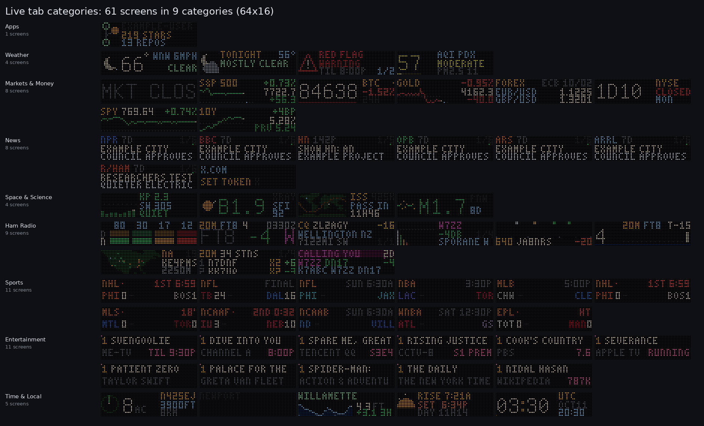
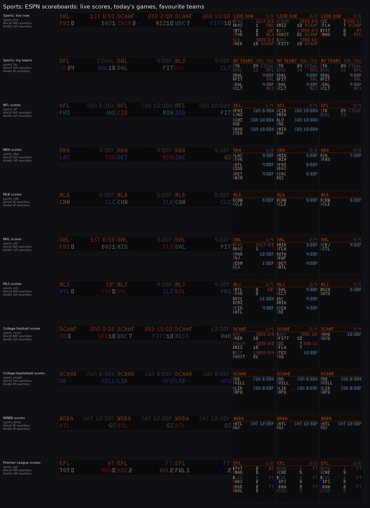
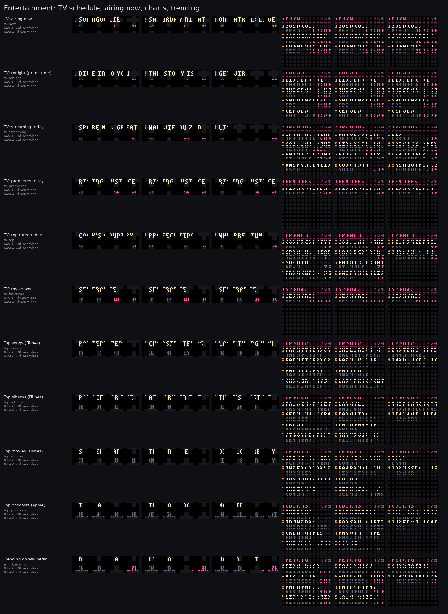
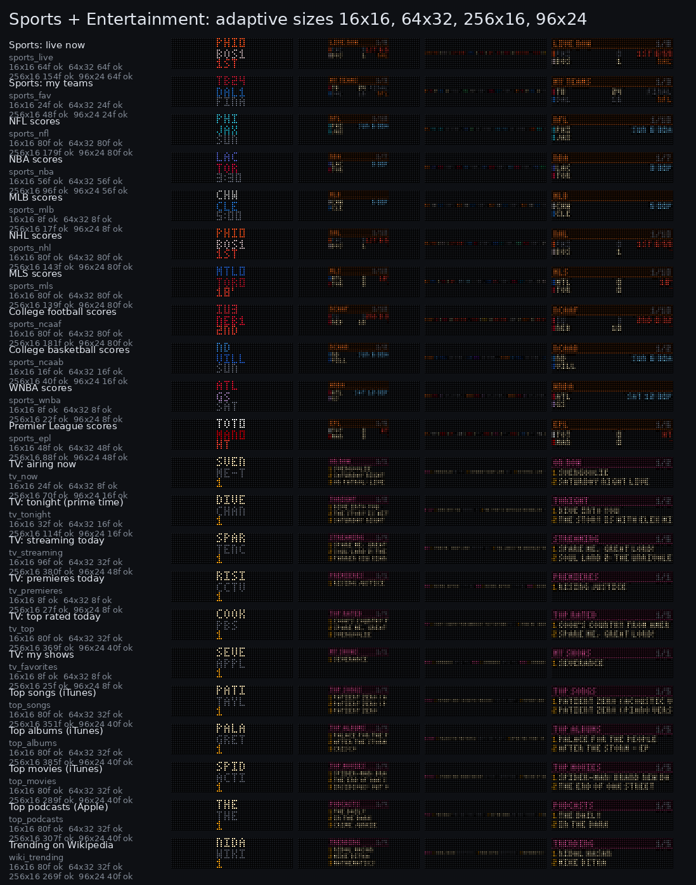

# Live sources and categories

The Live tab groups every live screen by category. Each category is a collapsible
section with an "all" switch, and each screen has its own **on** switch, which adds it to
the rotation. The search box filters by name, source, key or category. Live screens are
drawn by code from the data, so a screen costs a feed and a draw function, not an
animation library.

| Category | Screens |
|---|---|
| Apps | GitHub, plus shortcuts to OrcSDR Live and the AI status (Codex / Claude / Grok / ChatGPT) cards |
| Weather | weather now, forecast, alerts, air quality |
| Markets & Money | stocks, indexes, crypto, commodities, forex, market clock, sparkline, rates |
| News | NPR, BBC, Hacker News, Oregon, tech, ARRL, r/amateurradio, X (optional token) |
| Space & Science | Kp + solar wind, X-ray flares, ISS, earthquakes |
| Ham Radio | HF band conditions, 8 FT8 / FT4 screens (DX tools are coming later) |
| Sports | 9 league scoreboards, Live now, My teams |
| Entertainment | TV airing now, tonight, streaming, premieres, top rated, my shows; iTunes top songs, albums, movies, podcasts; Wikipedia trending |
| Time & Local | clock, sun and moon, tides, river, aircraft |



## Sports (ESPN, keyless)

The source is ESPN's public scoreboard JSON,
`https://site.api.espn.com/apis/site/v2/sports/<sport>/<league>/scoreboard`. It needs no
key, but it is undocumented, so OrcPixels treats it as best-effort.

- **League screens:** NFL, NBA, MLB, NHL, MLS, college football, men's college
  basketball, WNBA and the Premier League. Each shows today's slate: live games first,
  then upcoming games with their start time in your time zone, then finals.
- **Live now:** every game in progress across all the leagues. When nothing is live, it
  shows the next game to start.
- **My teams:** set `sports_favorites` under *Live sources* to ESPN abbreviations
  separated by spaces. To pin a team to one league, add the league in front, for example
  `POR SEA NBA.LAL`.
- **Polling:** a league is polled every 2 min while it has a game in progress and every
  15 min otherwise. The scoreboards go through a shared 45 s cache, so the Live now and
  My teams screens reuse the league fetches instead of adding requests.



## Entertainment (keyless)

| Screen | Source | Poll |
|---|---|---|
| TV: airing now | TVMaze `/schedule?country=` (network TV on air right now) | 5 min (schedule cached 20 min) |
| TV: tonight | TVMaze, 8 to 11 pm local | 15 min |
| TV: streaming today | TVMaze `/schedule/web` (your country + global platforms) | 15 min |
| TV: premieres today | TVMaze (episode 1 or a show premiering today) | 15 min |
| TV: top rated today | TVMaze show rating | 15 min |
| TV: my shows | TVMaze `singlesearch?embed=nextepisode`; set `tv_favorites` (`Severance/The Bear`) | 6 h |
| Top songs / albums / movies / podcasts | iTunes RSS charts `itunes.apple.com/us/rss/<chart>/limit=10/json` | 6 h |
| Trending on Wikipedia | Wikimedia pageviews top articles, yesterday (falls back to the day before) | 6 h |

There is no free, keyless box-office API, so *Top movies (iTunes)* stands in for it.
`tv_country` (default `US`) picks the TV schedule. Text from other scripts is dropped,
and accents are folded, because the 3x5 font is ASCII only.



## Rules every source follows

- **Read-only:** sources are HTTP GETs with a User-Agent and a 10 s timeout.
- **Failures:** when a fetch fails, the last good value stays on screen with a red stale
  dot. A source with no data shows its title with LOADING, NO DATA or SET UP. A broken
  plugin is logged and skipped.
- **Seamless loops:** pages flip every 8 frames, with the boundary offset half a page,
  and the live pulse is 4 frames, so the loop seam is an ordinary frame step. On 8:1+
  strips (256x16), the list becomes a marquee that wraps exactly at the loop end.
- **Adaptive layout:** the Sports and Entertainment screens draw natively at any size
  from the shared layout context ([DESIGN.md](DESIGN.md)). 64x16 and 64x64 are the native
  sizes. 16x16, 64x32, 256x16 and 96x24 are covered by the tests.



## Adding a category or a source (plugins)

```python
# orcpixels/live_plugins/myplugin.py  (then add "myplugin" to BUILTIN in live_plugins/__init__.py)
from .. import categories as CAT, live_adaptive as A
from ..sources import livefeeds as LF

CAT.category("transit", "Transit", order=95, color=(90, 200, 255), blurb="next departures")

class Departures(LF.Feed):
    key, title, source, poll_s = "transit_next", "Next departures", "My transit API", 120.0
    def fetch(self):
        return {"rows": [...]}            # runs in a worker thread; raise on failure

class DeparturesScreen(A.ListScreen):     # paged list at any size, marquee on strips
    key, short, feed, category, color = "transit_next", "DEPARTS", Departures, "transit", (90, 200, 255)
    def items(self, v):
        return [(r["route"], r["stop"], r["in"]) for r in v["rows"]]

SCREENS = [DeparturesScreen()]
```

Once the module is listed in `BUILTIN`, the engine, the `/api/livedata/*` routes, the Live
tab, the previews and the tests pick the screen up. To test a new source, add a recorded
response to `tests/fixtures/livedata/` and a route to `ROUTES` in
`tests/test_livedata.py`. Contact sheets come from `python tools/categories_sheet.py [outdir]`.
