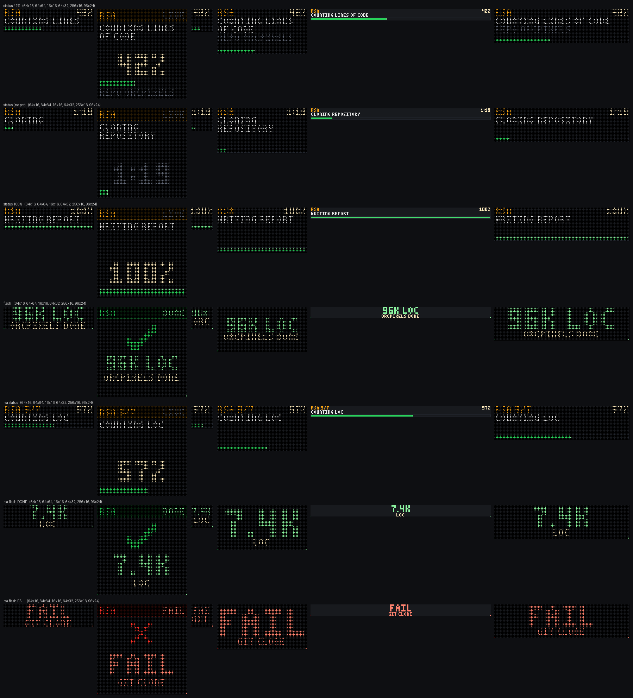

# Push API: show another app's status on the sign

Other programs on the same PC can put a progress screen or a short "done" flash on the
sign over plain HTTP, without knowing anything about BLE, presets or playlists. The RSA
Sandbox (`rsa.py`) is the first user.

- **Server:** `http://127.0.0.1:8765` (the OrcPixels app or `python -m orcpixels serve`).
- **Not released yet.** It is on branch `feat/push-api`. It ships in the first release after the branch is merged.



The preview shows 64x16 and 64x64 (native, golden-tested), then 16x16, 64x32, 256x16 and
96x24 (adaptive). Rows: status 42 %, status with no pct, status 100 %, flash, then the
RSA routes: status, flash DONE, flash FAIL.

## Endpoints

| Method and path | Body | What it does |
|---|---|---|
| `GET /api/health` | none | Cheap up-check: **200** when the sign is usable (connected), otherwise **503** with a `reason`. The body is the same JSON either way. |
| `POST /api/push/status` | `{source, title, step, pct, detail?, ttl_s}` | Shows a progress screen and keeps it up while it's fresh. |
| `POST /api/push/flash` | `{source, title, headline, sub?, seconds, ok?, tag?}` | Shows a short done flash. |
| `POST /api/push/clear` | `{source}` or `{}` for all sources | Ends it now, and the sign goes back to what it showed before. |
| `GET /api/push` | none | Board and engine state, for debugging. |
| `POST /api/rsa/status` | `{text, pct, line2}` | RSA alias for push status, `source: "rsa"`. |
| `POST /api/rsa/flash` | `{text: "DONE"\|"FAIL", number, label, ok, seconds}` | RSA alias for push flash. |
| `POST /api/rsa/clear` | none or `{}` | RSA alias for push clear. |

### `POST /api/push/status`

```json
{"source": "rsa", "title": "RSA", "step": "Counting lines of code", "pct": 42, "detail": "repo OrcPixels", "ttl_s": 30}
```

- `source`: who is pushing (max 40 chars). Each source has one status and one flash, and only the newest value is kept.
- `title`: short name for the title row (max 24). Defaults to `source`.
- `step`: what is happening now (max 120). Long text is word-wrapped and pages every ~3 s.
- `pct`: `0` to `100` draws a bar. `null` draws an animated "working" bar, with the elapsed time where the percentage would be.
- `detail`: optional second line (max 120). Shown on the 64x64. On a strip it pages after the step.
- `ttl_s`: the status disappears when no update arrives for this long. Default 30, range 2 to 3600. A crashed client never leaves the sign stuck.

### `POST /api/push/flash`

```json
{"source": "rsa", "title": "RSA", "headline": "96k LOC", "sub": "OrcPixels done", "seconds": 5}
```

- `headline` is drawn big. `sub` is the small line under it.
- `seconds` defaults to 5, range 2 to 30.
- `ok: false` draws it red with a cross. `tag` is the header word on tall panels, `DONE` or `FAIL` by default.
- A flash ends that source's status, so no clear is needed afterwards.

### RSA aliases (`/api/rsa/*`)

These match `F:\AI\RSA-Sandbox\rsa_orcpixels.py` exactly. Extra keys such as `source` and `run_id` are ignored.

- `status {"text": "Counting LOC", "pct": 57, "line2": "3/7"}` maps to push status with source `rsa`, title `RSA 3/7`, step `text` (first 24 chars) and `ttl_s` 60.
- `flash {"text": "DONE", "number": "7.4k", "label": "LOC", "ok": true, "seconds": 5}` maps to a flash with headline `number`, or `text` when there's no number, and sub `label`.
  - Green when `ok` is true. Red when it's false.
  - `ok` defaults to `text != "FAIL"`.
  - A bare number such as `96412` is shortened to `96K`.
- `clear` puts back whatever the sign showed before.

### Responses

Every POST answers right away and never waits for the sign:

```json
{"ok": true, "shown": true, "muted": false, "reason": null, "display": "strip", "sign_connected": true}
```

`shown: false` comes with a `reason`:
- `sign not connected`.
- `muted`: you took over the sign; see below.
- `another source (x) is newer`.

The request still succeeded. Bad JSON types give 422. A LAN client without a token set gives 403.

## How it behaves on the sign

- **It takes over like a live source.** The first fresh push stops OrcSDR Live, Live Data or Auto status and shows the push screen.
- **It goes back afterwards.** When nothing fresh is left (ttl expired, flash over, or cleared), the sign returns to what it showed before. In order:
  1. The live source or Auto status that was running.
  2. Otherwise the playlist or preset.
  3. Otherwise the last image or text.
  4. Otherwise the usual playlist fallback.
- **You always win.** If you send a preset, text, image, playlist or Live start while a push is showing, the push stops and that source is **muted** until its session ends (clear, flash or ttl expiry). Later pushes are accepted but not shown, so a running job never fights you.
- **Several sources:** a flash wins over a status, and otherwise the most recently updated source is shown.
- **Gentle on BLE:** it only uses the legacy transport, since the fast ones freeze the sign.
  - It sends at most one frame per second, and only when the frame changed.
  - Fast `pct` updates coalesce to the newest value, and the bar is quantised to pixels, so a client can post as often as it likes.
  - A known `pct` with one page of text is a static frame, so nothing is resent.
- **Several displays:** un-prefixed requests go to the primary display. Use `/d/<id>/api/push/...`, the `X-Display: <id>` header, or `?display=<id>` to target another one. `GET /api/health?display=<id>` checks that display.

## Auth

- OrcPixels listens on `127.0.0.1` only by default, and the push routes accept loopback clients.
- With `listen_lan` on, LAN clients can push only when a `lan_token` is set. They send it as an `X-OrcPixels-Token` header or `?token=`. A wrong token gets 401 from the LAN guard. With no token set, LAN pushes get 403.
- `/api/health` contains no private data and stays readable.

## Copy-paste client (stdlib only, fail-soft)

```python
import json, urllib.request

ORC = "http://127.0.0.1:8765"

def orc(path, body=None, timeout=0.3):
    """POST (body) or GET (no body). Returns True on 2xx; never raises."""
    try:
        data = None if body is None else json.dumps(body).encode()
        req = urllib.request.Request(ORC + path, data=data, method="GET" if body is None else "POST",
                                     headers={"Content-Type": "application/json"})
        with urllib.request.urlopen(req, timeout=timeout) as r:
            return 200 <= r.status < 300
    except Exception:
        return False

if orc("/api/health"):                       # 200 = OrcPixels up AND sign connected
    orc("/api/push/status", {"source": "myjob", "title": "BUILD", "step": "Compiling", "pct": 40, "ttl_s": 60})
    orc("/api/push/flash", {"source": "myjob", "title": "BUILD", "headline": "OK 42s", "sub": "all tests pass"})
    # RSA shapes: orc("/api/rsa/status", {"text": "Counting LOC", "pct": 57, "line2": "3/7"})
```

## Code and tests

- `orcpixels/push.py`: Board (pure state), renderers, PushLive engine and routes. `/api/health` is in `orcpixels/web.py`.
- `tests/test_push.py`: board rules, every size, golden references, engine (legacy frames, coalescing, restore, takeover and mute), routes, RSA aliases, health and the LAN rule.
- `python tools/push_previews.py [out.png]` renders the preview sheet. `python tools/push_previews.py --golden` deliberately updates `tests/golden/push.json`.
